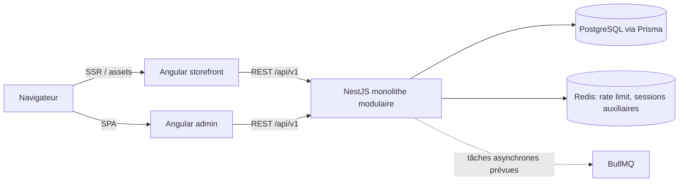
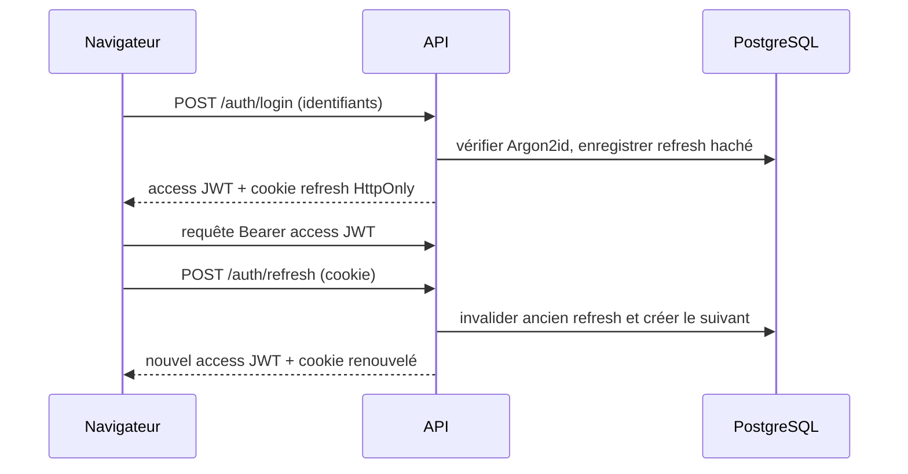

# Architecture technique

## Vue d’ensemble

Le dépôt regroupe `backend/` et le workspace Nx `frontend/`. Nx fournit le graphe de projets et les frontières des libs; Angular CLI conserve la responsabilité des builds Angular et du SSR. PostgreSQL est la source de vérité. Les montants sont des entiers XAF et les identifiants sont des UUID.

## Décisions de structure

- **Monolithe modulaire NestJS** : déploiement simple; modules métier séparés et dépendances unidirectionnelles.
- **Prisma + PostgreSQL** : migrations versionnées et requêtes typées; aucun SQL concaténé.
- **Nx dans le workspace frontend** : cache et graphe applicatif pour storefront, admin et libs; CLI Angular standard pour éviter de détourner le pipeline SSR.
- **Angular SSR + hydratation** pour le catalogue; la réponse API est transférée à l’hydratation pour limiter le double appel.
- **JWT d’accès en mémoire + refresh HttpOnly** : aucun jeton d’accès dans le stockage navigateur; rotation et révocation côté serveur.

## Authentification

## Flux de commande prévu

Le panier est revalidé côté API avant toute commande. Le serveur relit les prix, variantes et stocks, réserve le stock dans une transaction, fige les informations de ligne dans `OrderItem`, puis émettra les événements de préparation, paiement et livraison. Aucune commande transactionnelle complète n’est activée dans cette fondation.

## Dossiers

- `backend/src/modules/` : modules métier et contrôleurs HTTP.
- `backend/src/infrastructure/` : adaptateurs techniques (base, cache, messagerie).
- `frontend/apps/` : applications exécutables; `frontend/libs/` : bibliothèques partagées.
- `infra/docker/` : images multi-étapes et configuration du reverse proxy.
