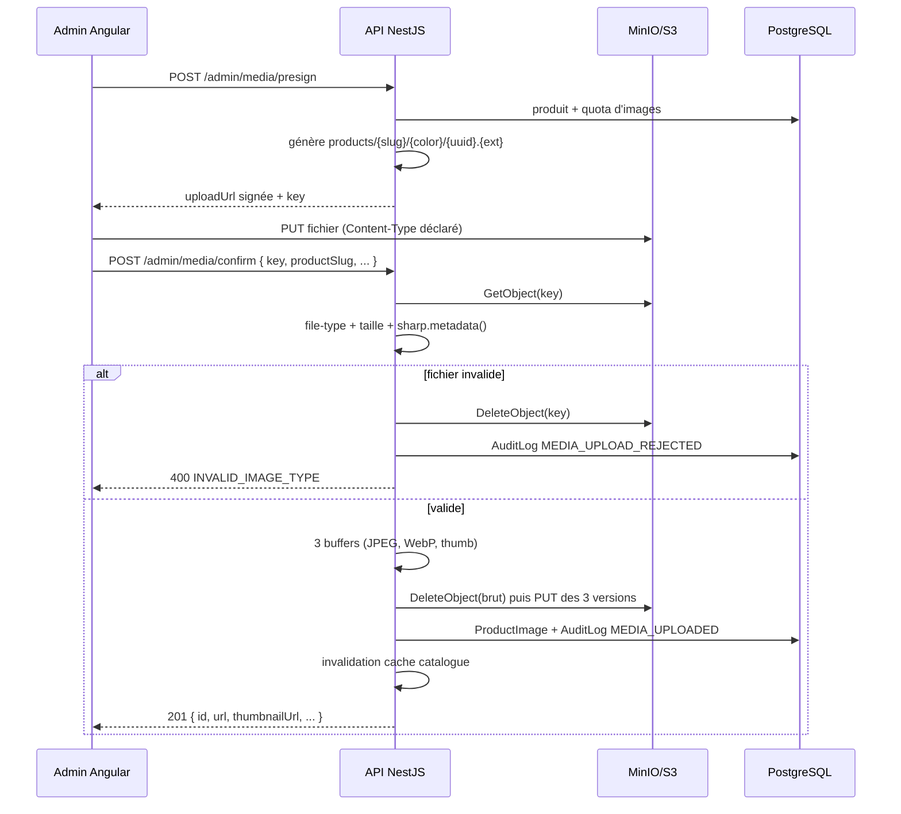

# Médias produits — téléversement sécurisé (CAT-05)

Documentation du module média de BRUNY SHOPPING : URLs signées, validation
magic bytes, traitement `sharp`, stockage MinIO/S3 et gestion des images
`ProductImage`.

## Architecture

```text
Admin Angular ──POST /admin/media/presign──▶ AdminMediaController
       │                                           │
       │◀──────── uploadUrl signée ────────────────┘
       │
       ├──PUT direct────────────────────────────▶ MinIO/S3 (bucket brunyshop-media)
       │
       └──POST /admin/media/confirm──▶ MediaService
                                           │
                                           ├─ download(key) (S3 GetObject)
                                           ├─ ImageProcessorService (file-type + sharp)
                                           ├─ upload 3 versions (JPEG, WebP, thumb)
                                           ├─ delete fichier brut
                                           ├─ ProductImage + AuditLog (transaction)
                                           └─ CatalogCacheService.invalidateProducts()
```

Le presign ne valide **pas** le contenu : à cet instant le fichier n’existe pas
encore. Le confirm re-télécharge le fichier et applique la validation réelle
(magic bytes + taille + décodage). C’est le seul moyen de respecter à la fois
l’URL signée (CA #1) et le contrôle du fichier (CA #2, #5).

### Providers

| Provider | Usage | Stockage |
|---|---|---|
| `S3StorageProvider` | dev/prod | MinIO, AWS S3, Cloudflare R2 (AWS SDK v3) |
| `LocalStorageProvider` | dev sans MinIO | `backend/storage/uploads/` (hors `public/`, `dist/`, `src/`) |
| `FakeStorageProvider` | tests/CI | Map mémoire, aucune dépendance externe |

Sélection : `STORAGE_PROVIDER=s3|local|fake`. L’ancienne variable
`STORAGE_DRIVER` reste acceptée (`minio` → `s3`). Sans variable, le provider
`local` est utilisé pour qu’un clone neuf et la CI démarrent sans MinIO.

Le module `StorageModule` expose un unique token DI `STORAGE_PROVIDER` ; aucun
client S3 n’est dupliqué.

## Flow presign + confirm



## Validation et traitement

- Formats autorisés : **JPEG, PNG, WebP**. Le type est détecté par `file-type`
  depuis les magic bytes ; le `Content-Type` et l’extension du client ne sont
  jamais utilisés pour valider.
- Refusés : PDF, SVG, GIF, ZIP, exécutables (`MZ`), texte, fichiers vides ou
  corrompus.
- Taille : `STORAGE_MAX_FILE_SIZE_MB` (défaut 5 Mo), contrôlée sur le buffer
  réel au confirm.
- `sharp.metadata()` vérifie que l’image se décode réellement.
- Sorties :
  - original JPEG q90, max 2000 px, rotation EXIF appliquée ;
  - WebP q85, max 1600 px ;
  - vignette WebP q80, 400×400 `cover` centrée.
- `fit: 'inside'` et `withoutEnlargement: true` préservent les proportions et
  n’agrandissent jamais une petite image.

## Nommage et stockage

- Aucun nom de fichier client n’est conservé (path traversal, injection).
- Clé : `products/{productSlug}/{color|common}/{uuid}.{jpg|webp}`.
- Trois versions : `{uuid}.jpg`, `{uuid}.webp`, `{uuid}-thumb.webp`.
- `ProductImage.storageKey` retient la clé WebP ; l’original et la vignette en
  sont dérivés pour la suppression.
- Les images existantes sans `storageKey` (créées avant CAT-05) sont prises en
  charge via l’URL publique.
- Aucun stockage dans `public/`, `dist/`, `node_modules/` ou la racine web.
- En local, un contrôleur public en lecture seule sert les fichiers avec
  validation de clé ; les écritures passent par une URL signée HMAC courte.

## Endpoints

### `POST /api/v1/admin/media/presign`

Rôles : `STOCK_MANAGER`, `ADMIN`, `SUPER_ADMIN`. Rate limit : 30/min/IP.

```json
{
  "productSlug": "sneakers-urbanstep-lady",
  "variantColor": "rose",
  "contentType": "image/jpeg",
  "declaredSize": 102400
}
```

```json
{
  "uploadUrl": "http://localhost:19000/brunyshop-media/products/...?X-Amz-...",
  "key": "products/sneakers-urbanstep-lady/rose/861643ef-....jpg",
  "publicUrl": "http://localhost:19000/brunyshop-media/products/...jpg",
  "expiresIn": 300,
  "method": "PUT",
  "headers": { "Content-Type": "image/jpeg" }
}
```

Erreurs : `PRODUCT_NOT_FOUND` (404), `MAX_IMAGES_REACHED`, `FILE_TOO_LARGE`,
`VALIDATION_ERROR` (forme ou type MIME).

### `POST /api/v1/admin/media/confirm`

```json
{
  "key": "products/sneakers-urbanstep-lady/rose/861643ef-....jpg",
  "productSlug": "sneakers-urbanstep-lady",
  "variantColor": "rose",
  "position": 0,
  "alt": "Vue de profil"
}
```

```json
{
  "id": "6ec54cfd-be2f-40e4-b6c7-284601b61684",
  "url": "http://localhost:19000/brunyshop-media/products/.../861643ef-....webp",
  "thumbnailUrl": "http://localhost:19000/brunyshop-media/products/.../861643ef-...-thumb.webp",
  "alt": "Vue de profil",
  "position": 0,
  "variantColor": "ROSE"
}
```

Refus réel d’un PDF :

```json
{
  "statusCode": 400,
  "code": "INVALID_IMAGE_TYPE",
  "message": "Format non autorisé. Formats acceptés : JPEG, PNG, WebP."
}
```

Le fichier brut est supprimé, aucune ligne `ProductImage` n’est créée et
`MEDIA_UPLOAD_REJECTED` est audité.

### `DELETE /api/v1/admin/media/images/:id`

Supprime les trois versions, la ligne `ProductImage`, audite `MEDIA_DELETED` et
invalide le cache. Réponses : `204`, `404 IMAGE_NOT_FOUND`.

### `PATCH /api/v1/admin/media/images/reorder`

```json
{
  "productId": "…",
  "order": [
    { "id": "…", "position": 0 },
    { "id": "…", "position": 1 }
  ]
}
```

Vérifie que toutes les images appartiennent au produit, met à jour les positions
en transaction, audite `MEDIA_REORDERED` et invalide le cache.

## Configuration

| Variable | Défaut | Description |
|---|---|---|
| `STORAGE_PROVIDER` | `local` (exemple : `s3`) | `s3`, `local`, `fake` |
| `STORAGE_MAX_FILE_SIZE_MB` | `5` | Taille max par fichier (1–20 Mo) |
| `STORAGE_PRESIGN_EXPIRES_SECONDS` | `300` | Durée de l’URL signée (60–900 s) |
| `STORAGE_MAX_IMAGES_PER_PRODUCT` | `10` | Quota par produit |
| `STORAGE_LOCAL_ROOT` | `storage/uploads` | Racine locale (hors dossier exécutable) |
| `MEDIA_BUCKET` | `S3_BUCKET` / `brunyshop-media` | Bucket dédié |
| `MEDIA_PUBLIC_URL` | `${S3_ENDPOINT}/${bucket}` | Base des URLs publiques |
| `MEDIA_UPLOAD_BASE_URL` | `API_PUBLIC_URL` / `http://localhost:${PORT}` | Base de l’upload local |
| `S3_ENDPOINT` | — | MinIO/S3/R2 |
| `S3_REGION` | `us-east-1` | Région |
| `S3_ACCESS_KEY_ID` / `S3_SECRET_ACCESS_KEY` | — | Credentials backend uniquement |
| `S3_FORCE_PATH_STYLE` | `true` | Requis par MinIO |

Les credentials ne sont **jamais** renvoyés au frontend : seul le backend signe.

### Initialisation MinIO

```bash
# .env : STORAGE_PROVIDER=s3, MEDIA_BUCKET=brunyshop-media, credentials MinIO
pnpm -C backend media:init
```

Le script crée le bucket s’il manque et applique une policy de lecture publique
(`s3:GetObject` sur `bucket/*`), sans autoriser l’écriture anonyme.

## Sécurité

- `JwtAuthGuard` global + `RolesGuard` + `@Roles` sur toutes les routes admin.
- Rate limit 30/min/IP sur le presign.
- Validation magic bytes et taille réelles au confirm.
- Quota revérifié au confirm (presigns concurrents).
- Clé vérifiée (préfixe produit/couleur, UUID, pas de `..`).
- Fichier brut et versions partielles nettoyés en cas d’échec.
- Aucun binaire ni credential loggé.
- Bucket dédié, lecture publique, écriture réservée au backend.
- Cache invalidé après confirm, delete et reorder.
- Audit : `MEDIA_PRESIGN_GENERATED`, `MEDIA_UPLOADED`,
  `MEDIA_UPLOAD_REJECTED`, `MEDIA_DELETED`, `MEDIA_REORDERED`.

## Presign + confirm vs multipart direct

Le flux **presign + confirm** est retenu : il respecte l’URL signée et permet
une validation réelle après upload. L’alternative multipart direct (un seul
appel, fichier en mémoire) serait plus simple mais ne fournirait pas d’URL
signée et ferait transiter l’image par l’API. Le flux actuel est adapté aux
fichiers jusqu’à 5 Mo et à un CDN en production.

## Exploitation

- Dev : MinIO sur `localhost:19000` (API) et `19001` (console).
- Prod : S3/R2 + CDN (`MEDIA_PUBLIC_URL=https://media.brunyshop.cm/...`).
- Les images publiques sont immuables (UUID) et mises en cache un an.
- Un changement d’image invalide immédiatement le cache catalogue Redis.
