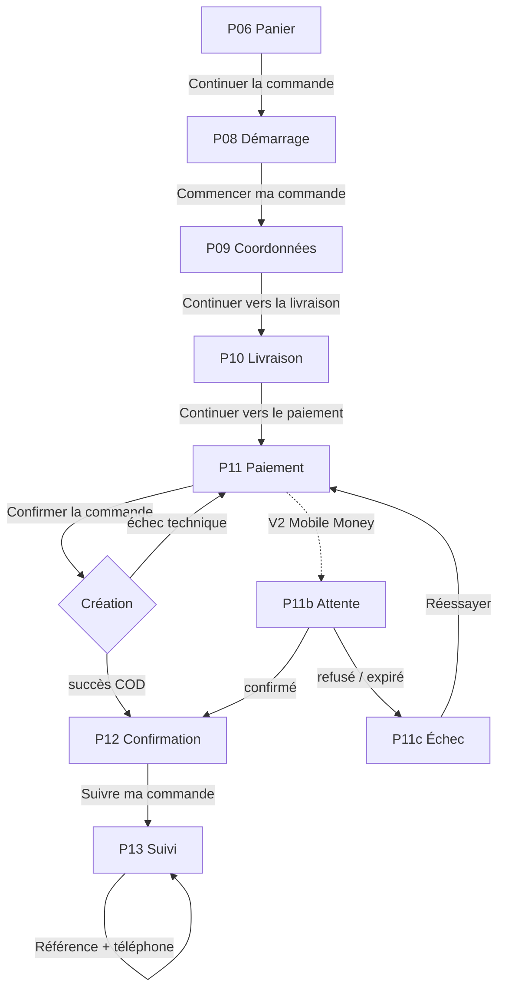

# PARCOURS — Tunnel de commande et suivi (P08 → P13)

> DSG-04 · conception uniquement · branche `feature/DSG-04-checkout-tracking-design`
> Ce document décrit le flux commun. Chaque écran a sa propre spec.

---

## 1. Objectif

Définir un tunnel de commande **invité**, linéaire et court, adapté au marché camerounais : commande sans inscription, contact WhatsApp obligatoire, livraison à Douala et Yaoundé, paiement à la livraison après essayage. Le suivi de commande est accessible publiquement avec une preuve de possession (référence + téléphone) ou un lien signé.

Le parcours doit rester compréhensible avec une connexion mobile instable : peu de champs, sauvegarde locale de la saisie, messages d'erreur explicites, aucun blocage silencieux.

---

## 2. Principes

1. **Trois étapes, une décision par écran.** P09 coordonnées, P10 livraison, P11 paiement. P08 est une entrée, pas une étape.
2. **Rien n'est payé en ligne en MVP.** Le paiement à la livraison est le seul mode actif ; Mobile Money est visible mais désactivé (« Bientôt disponible »).
3. **La saisie n'est jamais perdue.** Retour arrière, rafraîchissement et erreur réseau conservent les valeurs.
4. **Une seule action principale par écran**, avec le total visible sur mobile.
5. **Chaque erreur dit comment corriger**, jamais seulement ce qui ne va pas.
6. **Aucune promesse non tenue** : pas de « paiement sécurisé » en ligne, pas de suivi GPS temps réel, pas d'heure de livraison garantie.
7. **Le suivi est public mais protégé** : référence + téléphone, ou lien signé émis à la confirmation.

---

## 3. Vue d'ensemble



### 3.1 Correspondance ticket

| Code | Écran | Route proposée | Étape du stepper |
| --- | --- | --- | --- |
| P08 | Démarrage du checkout | `/commande` | aucune |
| P09 | Coordonnées | `/commande/coordonnees` | 1 |
| P10 | Livraison | `/commande/livraison` | 2 |
| P11 | Paiement | `/commande/paiement` | 3 |
| P11b | Attente de paiement (V2) | `/commande/paiement/attente` | 3 |
| P11c | Échec de paiement (V2) | `/commande/paiement/echec` | 3 |
| P12 | Confirmation | `/commande/confirmation/:reference` | — |
| P13 | Suivi public | `/suivi` et `/suivi/:reference` | — |

Les routes sont **proposées** : elles informent l'implémentation, elles ne constituent pas un contrat.

---

## 4. Règles de navigation

| Situation | Comportement |
| --- | --- |
| Panier vide à l'entrée de `/commande` | Redirection vers `/panier` avec message « Votre panier est vide. Ajoutez une paire pour commander. » |
| Retour depuis P09 | Retour à P08 ; la saisie est conservée |
| Retour depuis P10 | Retour à P09 ; les champs restent remplis et valides |
| Retour depuis P11 | Retour à P10 ; le mode de paiement reste sélectionné |
| Clic sur une étape précédente du stepper | Autorise le retour si l'étape est complétée ; sinon l'étape est désactivée |
| Clic sur une étape future | Désactivé, jamais cliquable |
| Rafraîchissement | La saisie est restaurée depuis `sessionStorage` ; aucune commande n'est créée |
| Fermeture de l'onglet | La saisie locale est conservée 24 h, puis purgée |
| Abandon après saisie | Aucune commande, aucun message ; le panier reste intact |
| Double clic sur « Confirmer la commande » | Désactivation immédiate du bouton + clé d'idempotence ; une seule commande |
| Perte de connexion pendant la confirmation | Écran d'erreur avec « Réessayer » ; aucune commande en double |
| Commande déjà créée (retour navigateur sur P11) | Redirection vers P12 de la commande existante |

### 4.1 Reprise

Le tunnel stocke un brouillon local :

```text
{
  name, phone, city, district, landmark, slot,
  paymentMethod, cartFingerprint, updatedAt
}
```

Si le `cartFingerprint` ne correspond plus au panier actuel, le brouillon d'adresse est conservé mais l'utilisateur est prévenu : « Votre panier a changé. Vérifiez les articles avant de confirmer. »

---

## 5. Règles métier

### 5.1 Identité

- **Nom** : 2 à 80 caractères, lettres, espaces, apostrophes et traits d'union.
- **Téléphone** : 9 chiffres après `+237`, commence par `6` (mobile). Normalisé `6XXXXXXXX`. Sert d'identifiant de contact et de preuve pour le suivi.
- Aucun compte, aucun mot de passe, aucun e-mail en MVP.

### 5.2 Livraison

| Zone | Frais | Délai affiché |
| --- | --- | --- |
| Douala | 1 500 FCFA | Express 24 h |
| Yaoundé | 2 000 FCFA | 24 à 48 h |
| Autres villes | Sur devis WhatsApp | Non promis |

- **Livraison offerte dès 2 paires** : `shippingFee = 0`, mention « Offerte ».
- Le quartier et le point de repère sont **obligatoires** : sans repère, le coursier ne trouve pas l'adresse.
- Créneau : proposé par zone (matin 8 h–12 h, après-midi 13 h–17 h, soir 17 h–19 h). Le créneau est une **préférence**, jamais une garantie.
- Zone non desservie : blocage avec alternative WhatsApp, pas de commande.

### 5.3 Paiement

- `COD` actif, libellé « Paiement à la livraison », description « Espèces, Orange Money ou MTN MoMo remis au coursier après essayage ».
- `MOBILE_MONEY` visible, désactivé, badge « Bientôt disponible ». Aucun clic, aucun formulaire.
- **CGV obligatoires** : case non cochée par défaut, lien vers les conditions.
- Le montant affiché est le total final, frais compris. Aucun frais caché.

### 5.4 Commande

- Référence **`BRN-YYMM-XXXX`** (ex. `BRN-2611-7K3F`), unique, non devinable. Affichée avec `#`.
- Statut initial : `PENDING_CONFIRMATION`, `paymentStatus = PENDING`, `paymentMethod = COD`.
- `addressSnapshot` figé à la création : une modification ultérieure de l'adresse ne change pas l'historique.
- `idempotencyKey` généré côté client par tentative de confirmation.
- Une commande créée n'est jamais supprimée : `deletedAt` seulement.

### 5.5 Suivi

- Accès par **lien signé** (jeton court, émis à la confirmation) ou par **référence + téléphone**.
- Trois échecs de vérification en 10 minutes → limitation temporaire.
- Les données personnelles sont **partiellement masquées** avant vérification (nom `J***-P***`, téléphone `6** ** ** 44`).
- Le suivi ne permet **aucune modification** : pas d'annulation, pas de changement d'adresse en ligne.

---

## 6. Matrice écrans × états

| Écran | Nominal | Chargement | Vide | Erreur | Succès |
| --- | --- | --- | --- | --- | --- |
| P08 | Récapitulatif + garanties | Squelette du récap | Panier vide → redirection | Panier indisponible, réessai | — |
| P09 | Formulaire prérempli | Enregistrement du brouillon | Champs vides | Erreurs de champ, erreur réseau | Étape validée |
| P10 | Zones + créneaux | Calcul des frais | Aucune zone disponible | Zone non desservie, frais indisponibles | Étape validée |
| P11 | COD sélectionné | Création en cours | — | Création échouée, stock épuisé | Redirection P12 |
| P11b | Attente Mobile Money (V2) | Statut en cours | — | Expiré, annulé | Paiement confirmé |
| P11c | Échec expliqué (V2) | — | — | Refus, expiration, réseau | Nouvelle tentative |
| P12 | Commande confirmée | Confirmation en cours | Référence inconnue | Lien invalide, erreur serveur | — |
| P13 | Suivi vérifié | Vérification / chargement | Aucune commande pour ce numéro | Référence introuvable, trop de tentatives | Statut à jour |

Chaque spec détaille ces états avec leurs microtextes.

---

## 7. États d'affichage du suivi

Le suivi public ne montre pas les statuts techniques. Cinq étapes d'affichage sont dérivées :

| # | Étape affichée | Dérivée de | Horodatage |
| --- | --- | --- | --- |
| 1 | Commande enregistrée | `Order.createdAt` | date + heure |
| 2 | Préparation & contrôle qualité | `CONFIRMED` → `PREPARING` | date + heure |
| 3 | Prise en charge par le coursier | `Shipment.ASSIGNED` puis `SHIPPED` | date + heure |
| 4 | En cours de livraison | `Shipment.IN_TRANSIT` | estimation, jamais une heure passée |
| 5 | Livrée et réglée | `DELIVERED` (+ `paidAt` si COD collecté) | date + heure |

Branches d'exception :

| Statut | Affichage public |
| --- | --- |
| `CANCELLED` | « Commande annulée » + motif + WhatsApp |
| `DELIVERY_FAILED` | « Livraison reportée » + « Nous vous rappelons » |
| `RETURN_REQUESTED` / `RETURNED` | « Retour en cours » |
| `REFUNDED` | « Remboursée » |
| `EXCHANGED` | « Échange effectué » |

Règle : **une seule étape est « en cours »**, les précédentes sont cochées, les suivantes sont « À venir ».

---

## 8. Données partagées entre écrans

| Donnée | Source | Écrans |
| --- | --- | --- |
| Lignes du panier, quantités, total | `CartStore` | P08, P11, P12 |
| Nom, téléphone | saisie P09 | P10, P11, P12, P13 |
| Ville, quartier, repère, créneau | saisie P10 + zones API | P11, P12, P13 |
| Frais de livraison | zone sélectionnée | P08, P10, P11, P12 |
| Mode de paiement | sélection P11 | P12, P13 |
| Référence, statut, timeline | API commande | P12, P13 |

Le **total** est calculé une seule fois côté client pour l'affichage, puis **recalculé côté serveur** à la création. En cas d'écart, le serveur fait foi et l'écran P11 affiche le nouveau total avant de demander une confirmation.

---

## 9. Transitions et conditions

| Depuis | Action | Condition | Vers |
| --- | --- | --- | --- |
| P08 | Commencer ma commande | panier ≥ 1 ligne | P09 |
| P09 | Continuer vers la livraison | nom + téléphone valides | P10 |
| P10 | Continuer vers le paiement | ville + quartier + repère + créneau | P11 |
| P11 | Confirmer la commande | CGV cochées + mode actif + total à jour | P12 |
| P11 | Confirmer (échec) | — | P11 avec `Alert` |
| P12 | Suivre ma commande | référence + jeton | P13 |
| P12 | Retour à la boutique | — | `/boutique` |
| P13 | Vérifier | référence + téléphone valides | P13 vérifié |
| P13 | Demander un échange | commande livrée depuis ≤ 7 jours | WhatsApp prérempli |

---

## 10. Cas limites

1. **Panier modifié dans un autre onglet** : au retour sur P11, le total est recalculé et un bandeau demande confirmation.
2. **Stock épuisé entre P10 et P11** : blocage à la confirmation, retour au panier avec la ligne concernée mise en évidence.
3. **Zone supprimée entre P10 et P11** : message « Cette zone n'est plus desservie », retour à P10.
4. **Téléphone invalide** : `6` + 8 chiffres ; les numéros commençant par `2` (fixe) sont refusés avec explication.
5. **Double soumission** : clé d'idempotence, bouton désactivé, une seule commande.
6. **Commande introuvable** : message neutre, jamais « ce numéro n'existe pas » (anti-énumération).
7. **Trop de tentatives de suivi** : blocage 10 minutes avec compte à rebours.
8. **Lien de suivi expiré** : formulaire manuel proposé.
9. **Coursier non assigné** : bloc coursier masqué, aucune donnée personnelle affichée.
10. **Estimation dépassée** : « Arrivée imminente » au lieu d'une heure passée.

---

## 11. Hors périmètre

- Paiement Mobile Money direct (PAY-02) : écrans P11b/P11c spécifiés en V2, non implémentés.
- Paiement par carte (PAY-05).
- Création de compte, connexion, historique client.
- Annulation ou modification de commande en ligne.
- Suivi GPS temps réel et carte interactive.
- Back-office de dispatch.
- Notifications SMS/WhatsApp automatiques (dépendance externe).

---

## 12. Références

- `docs/design/DSG-04/ANALYSE-EXISTANT.md`
- `docs/design-1/ANALYSE-MAQUETTES.md` (P01–P07)
- `docs/design-system/tokens-reference.md`
- `docs/design-system/ASSUMPTIONS.md`
- `backend/prisma/schema.prisma` — `Order`, `OrderItem`, `Payment`, `Shipment`, `DeliveryZone`
- `frontend/apps/storefront/src/app/features/cart/cart-page.ts`
