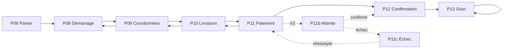
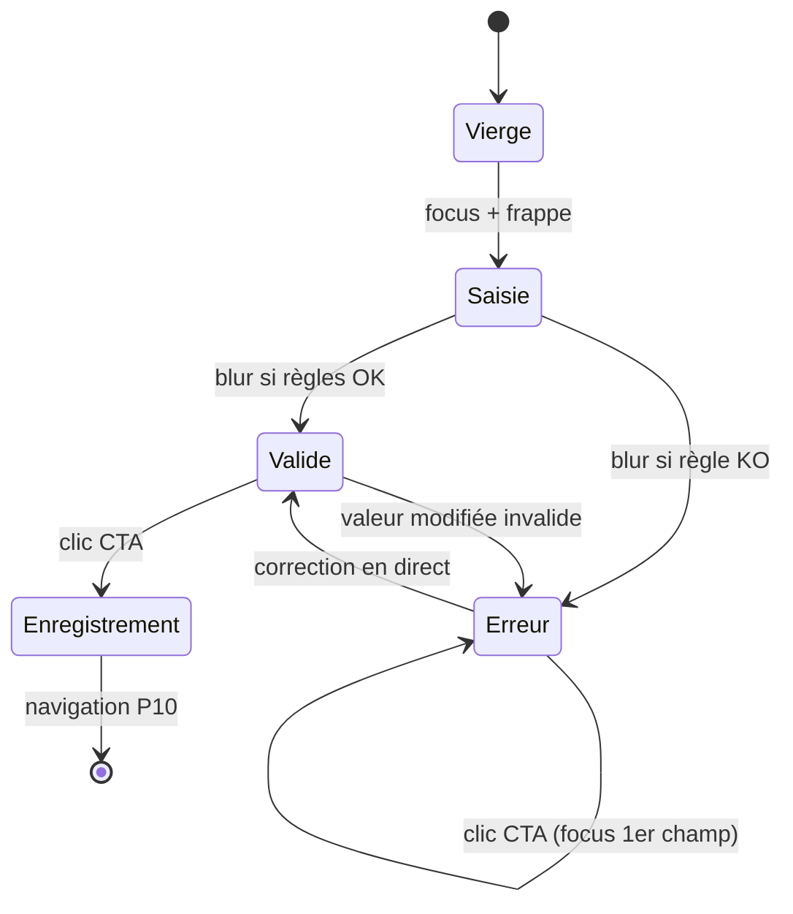
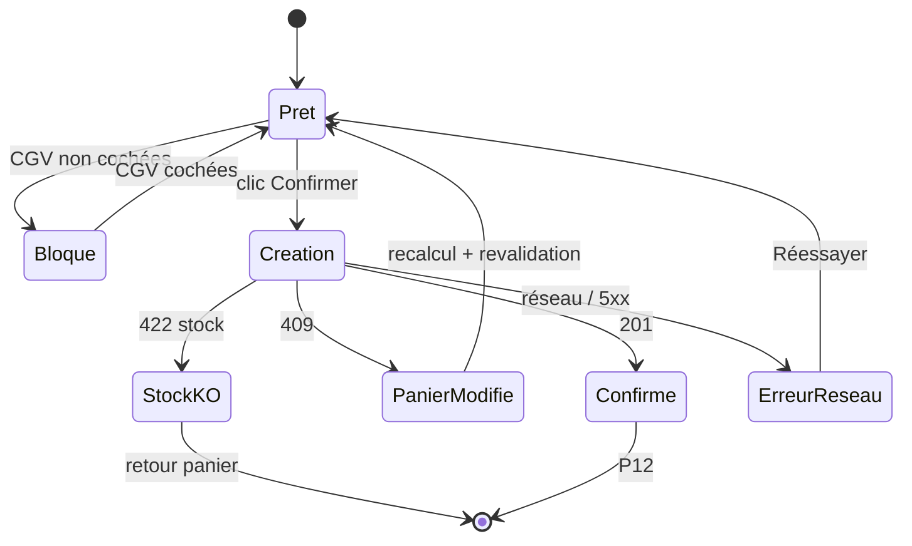
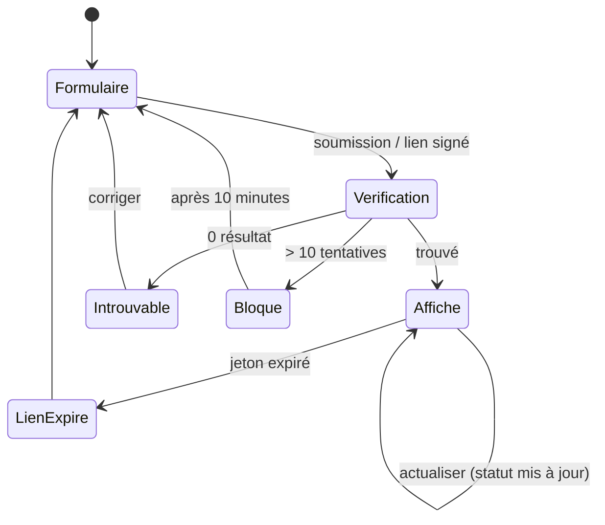

# PROTOTYPE — P08 à P13

> DSG-04 · **Option B** : aucun outil de maquettage interactif n'est disponible pour ce projet
> (ni Figma, ni Penpot, ni export par écran). Le prototype est donc décrit par diagrammes Mermaid,
> wireframes ASCII et **10 scénarios de navigation vérifiables**.

---

## 1. Méthode

| Option | Faisabilité | Décision |
| --- | --- | --- |
| A — Prototype Figma / Penpot cliquable | Aucun fichier source, aucun compte, aucun export | **Écartée** |
| B — Mermaid + wireframes ASCII + scénarios | Réalisable en Markdown, versionnable, relu en revue | **Retenue** |
| C — Prototype HTML/CSS | Contredit « conception uniquement », risque de figer des choix prématurés | **Écartée** |

Un prototype HTML pourra être produit dans un ticket dédié après validation de `VALIDATION.md`.

---

## 2. Navigation générale



Retours autorisés en trait plein, V2 en pointillé, boucle de vérification sur P13.

---

## 3. Diagrammes d'états

### 3.1 P09 — validation des champs



### 3.2 P11 — création de commande



### 3.3 P13 — vérification du suivi



---

## 4. Bande de wireframes

Vue consolidée du tunnel (détails complets dans chaque spec).

```text
P08                P09                P10                P11
┌──────────┐       ┌──────────┐       ┌──────────┐       ┌──────────┐
│ ○ ○ ○    │       │ ● ○ ○    │       │ ● ● ○    │       │ ● ● ●    │
│ Votre    │       │ Nom      │       │ Ville    │       │ COD  ●   │
│ commande │  →    │ Tél      │  →    │ Quartier │  →    │ MoMo ○   │
│ 2 lignes │       │ ☑ appel  │       │ Repère   │       │ ☐ CGV    │
│ Total    │       │ Total    │       │ Créneau  │       │ Total    │
│ [Commen- │       │ [Contin- │       │ [Contin- │       │ [Confir- │
│  cer  →] │       │  uer  →] │       │  uer  →] │       │  mer   ] │
└──────────┘       └──────────┘       └──────────┘       └──────────┘

P12                P13 (vérif.)      P13 (suivi)
┌──────────┐       ┌──────────┐       ┌──────────┐
│ ✓        │       │ Référence│       │ Statut   │
│ Confirmée│       │ Tél      │       │ Coursier │
│ Ticket   │  →    │ [Voir  ] │  →    │ Timeline │
│ Articles │       │          │       │ Adresse  │
│ Livraison│       │          │       │ Montant  │
│ [Suivre] │       │          │       │ Échange  │
└──────────┘       └──────────┘       └──────────┘
```

---

## 5. Dix scénarios de navigation

Chaque scénario a été déroulé mentalement écran par écran contre les specs. Statut : **conforme** si aucun écran ne manque de contenu, d'action ou d'état pour le cas.

### Scénario 1 — Commande COD nominale

| Étape | Écran | Attendu |
| --- | --- | --- |
| 1 | P06 | CTA actif « Commencer ma commande » |
| 2 | P08 | Récapitulatif 2 paires, total 52 500 FCFA, livraison offerte |
| 3 | P09 | Nom + `6 94 28 10 44` valides, case appel cochée |
| 4 | P10 | Douala, Bonapriso, repère saisi, après-midi |
| 5 | P11 | COD sélectionné, CGV cochées, total 52 500 FCFA |
| 6 | P12 | Référence `BRN-2611-7K3F`, ticket, livraison, CTA suivi |
| 7 | P13 | Timeline à l'étape 1, coursier masqué |

Statut : **conforme**.

### Scénario 2 — Téléphone invalide puis corrigé

P09 : saisie `2 22 30 40 50` → blur → erreur « Saisissez un numéro mobile commençant par 6. » ; correction en `6 94 28 10 44` → erreur disparaît sans soumettre ; CTA → P10. Statut : **conforme**.

### Scénario 3 — Repère manquant

P10 : quartier choisi, repère vide, CTA → focus sur le repère, erreur « Ajoutez un point de repère… » ; saisie de 6 caractères → « Décrivez le lieu en quelques mots (10 caractères minimum). » ; saisie complète → P11. Statut : **conforme**.

### Scénario 4 — Ville non desservie

P10 : sélection d'une ville hors zone → message « Nous ne livrons pas encore cette ville… » + WhatsApp, CTA bloqué. Le panier reste intact. Statut : **conforme**.

### Scénario 5 — CGV non cochées

P11 : CTA cliqué sans CGV → message d'erreur, focus sur la case, aucune requête réseau, bouton non passé en `loading`. Statut : **conforme**.

### Scénario 6 — Panier modifié dans un autre onglet

P11 : retour sur l'onglet, panier vidé par un autre onglet → bandeau « Votre panier est vide. Retournez à la boutique. », CTA désactivé. Si le panier a changé mais reste non vide → « Votre panier a changé… » + recalcul. Statut : **conforme**.

### Scénario 7 — Erreur réseau à la confirmation

P11 : clic Confirmer, réseau coupé → bouton `loading` puis erreur « Votre commande n'a pas été enregistrée… », CTA « Réessayer » ; second clic → une seule commande grâce à la clé d'idempotence ; succès → P12. Statut : **conforme**.

### Scénario 8 — Suivi manuel après perte du lien

P13 : saisie `BRN-2611-7K3F` + `6 94 28 10 44` → suivi affiché ; mauvais numéro → message neutre « Nous ne trouvons aucune commande avec ces informations. » ; 11e tentative → « Trop de tentatives. Réessayez dans 10 minutes. » Statut : **conforme**.

### Scénario 9 — Commande livrée et échange

P13 : statut « Livrée », coursier remplacé par « Commande livrée », montant marqué « Réglée », CTA « Demander un échange » actif ; après 7 jours → CTA désactivé avec « Le délai d'échange de 7 jours est dépassé. » Statut : **conforme**.

### Scénario 10 — Échec de paiement Mobile Money (V2)

P11 : Mobile Money est désactivé en MVP → aucun accès. En V2 : sélection MoMo → P11b attente → refus opérateur → P11c « Le paiement n'a pas abouti », motif « Code incorrect », CTA « Réessayer le paiement » → P11b ; alternative « Payer à la livraison » → P11 avec COD. Statut : **conforme en V2, chemin inactif en MVP**.

### 5.1 Synthèse

| Scénario | Écrans traversés | Statut |
| --- | --- | --- |
| 1 Commande nominale | P06 → P13 | Conforme |
| 2 Téléphone invalide | P09 | Conforme |
| 3 Repère manquant | P10 | Conforme |
| 4 Ville non desservie | P10 | Conforme |
| 5 CGV non cochées | P11 | Conforme |
| 6 Panier modifié | P11 | Conforme |
| 7 Erreur réseau | P11 → P12 | Conforme |
| 8 Suivi manuel | P13 | Conforme |
| 9 Commande livrée | P13 | Conforme |
| 10 Échec MoMo | P11 → P11c | Conforme (V2) |

**10 scénarios sur 10 sont couverts par les specs.** Aucun scénario ne nécessite un écran non spécifié.

---

## 6. Cas non couverts par le prototype

| Cas | Raison | Traitement |
| --- | --- | --- |
| Panier > 10 articles | Hors maquette | Le récapitulatif est défilable ; à valider en implémentation |
| Commande multi-adresses | Non prévu | Hors périmètre MVP |
| Retour produit complet | Hors DSG-04 | Ticket dédié |
| Notifications SMS automatiques | Dépendance externe | Hors périmètre |
| Paiement carte | V3 | Hors périmètre |

---

## 7. Limites

- Le prototype n'est **pas cliquable** : il est relu en revue de conception.
- Les transitions réelles (animations, durées) ne sont pas spécifiées finement : elles relèvent de l'implémentation.
- Les wireframes ASCII ne rendent pas compte du responsive réel ; les compositions 768 / 1280 sont décrites en texte dans chaque spec.
- Aucun test utilisateur n'a été mené.

---

## 8. Référence

- `PARCOURS.md`, `P08` à `P13`, `COMPOSANTS-REQUIS.md`, `MICROTEXTES.md`.
- `VALIDATION.md` — validation par le PO avant implémentation.
