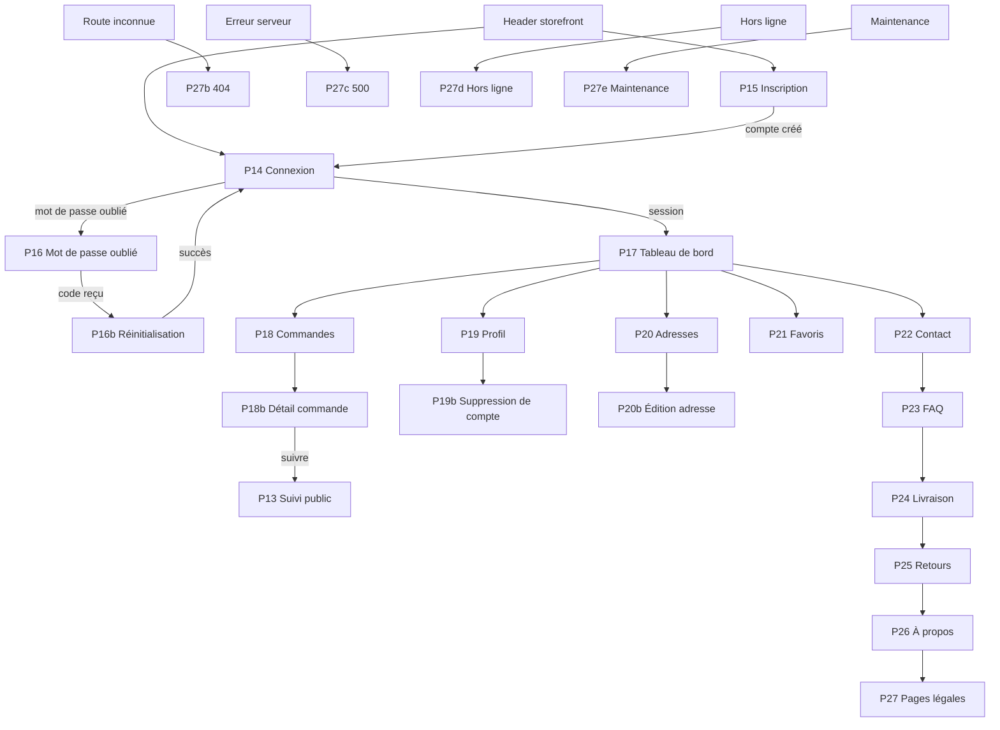
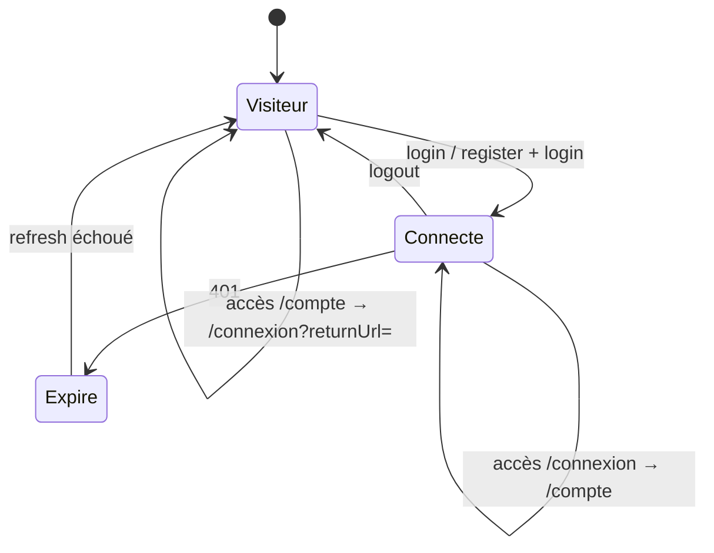

# CARTOGRAPHIE — P14 à P27

> DSG-05 · parcours compte, aide et erreurs.
> Les routes sont proposées ; les endpoints marqués **existant** sont ceux du backend actuel.

---

## 1. Vue d'ensemble

---

## 2. Groupes et routes

### Groupe 1 — Authentification

| Code | Écran | Route | Accès | Guard |
| --- | --- | --- | --- | --- |
| P14 | Connexion | `/connexion` | Visiteur | `guestGuard` |
| P15 | Inscription | `/inscription` | Visiteur | `guestGuard` |
| P16 | Mot de passe oublié | `/mot-de-passe-oublie` | Visiteur | `guestGuard` |
| P16b | Réinitialisation | `/reinitialiser-mot-de-passe` | Visiteur | `guestGuard` |

### Groupe 2 — Compte

| Code | Écran | Route | Accès | Guard |
| --- | --- | --- | --- | --- |
| P17 | Tableau de bord | `/compte` | Connecté | `authGuard` |
| P18 | Commandes | `/compte/commandes` | Connecté | `authGuard` |
| P18b | Détail commande | `/compte/commandes/:reference` | Connecté | `authGuard` |
| P19 | Profil | `/compte/profil` | Connecté | `authGuard` |
| P19b | Suppression | `/compte/supprimer` | Connecté | `authGuard` |
| P20 | Adresses | `/compte/adresses` | Connecté | `authGuard` |
| P20b | Nouvelle / édition | `/compte/adresses/nouvelle`, `/compte/adresses/:id` | Connecté | `authGuard` |
| P21 | Favoris | `/compte/favoris` | Connecté | `authGuard` |

### Groupe 3 — Information

| Code | Écran | Route | Accès |
| --- | --- | --- | --- |
| P22 | Contact | `/contact` | Public |
| P23 | FAQ | `/faq` | Public |
| P24 | Livraison | `/livraison` | Public |
| P25 | Retours | `/retours` | Public |
| P26 | À propos | `/a-propos` | Public |
| P27 | Pages légales | `/mentions-legales`, `/cgv`, `/politique-confidentialite` | Public |

### Groupe 4 — Erreurs

| Code | Écran | Route | Déclencheur |
| --- | --- | --- | --- |
| P27b | 404 | wildcard `**` | Route inconnue |
| P27c | 500 | `/erreur/500` | Erreur serveur non récupérable |
| P27d | Hors ligne | `/hors-ligne` | `navigator.onLine === false` |
| P27e | Maintenance | `/maintenance` | Indicateur backend / configuration |

---

## 3. Règles d'accès

- `authGuard` : si `SessionService.user()` est présent, laisse passer ; sinon tente `restore()` ; en cas d'échec, redirige vers `/connexion?returnUrl=<url>`.
- `guestGuard` : si une session existe, redirige vers `/compte`.
- Toute réponse `401` sur une route protégée déclenche un refresh unique ; si le refresh échoue, redirection vers P14 avec `sessionExpired=1`.
- `returnUrl` est validé : chemin interne commençant par `/`, jamais une URL absolue.

---

## 4. Navigation compte

| Breakpoint | Navigation |
| --- | --- |
| 360 px | En-tête de page + liste verticale des sections, ou onglets défilables |
| 768 px | Onglets horizontaux sous le titre |
| 1280 px | Sidebar fixe de 240 px + contenu |

Sections : Vue d'ensemble, Commandes, Profil, Adresses, Favoris, Déconnexion. Un fil d'Ariane « Accueil › Mon compte › … » est présent sur toutes les sous-pages.

---

## 5. Shells

| Contexte | Header | Footer | Bottom nav |
| --- | --- | --- | --- |
| Auth (P14–P16b) | Logo + « Retour à la boutique » | Réduit | Non |
| Compte (P17–P21) | Header storefront + lien compte actif | Complet | Oui, onglet Compte actif |
| Information (P22–P27) | Header storefront | Complet | Oui |
| Erreur (P27b–P27e) | Logo seul | Réduit | Non |

---

## 6. Endpoints utilisés

| Écran | Endpoint | État |
| --- | --- | --- |
| P14 | `POST /auth/login` | **Existant** |
| P14 (2FA) | `POST /auth/2fa/verify` | **Existant** (rôles admin) |
| P15 | `POST /auth/register` | **Existant** |
| P16 | `POST /auth/forgot-password` | **Existant** (e-mail uniquement) |
| P16b | `POST /auth/reset-password` | **Existant** (e-mail + code 6 chiffres) |
| P17, P19 | `GET /me` | **Existant** |
| P17, P18 | `GET /orders` | À créer |
| P18b | `GET /orders/:reference` | À créer |
| P19 | `PATCH /me` | À créer |
| P19 | `POST /me/password` | À créer |
| P19b | `DELETE /me` | À créer |
| P20, P20b | `GET/POST/PATCH/DELETE /addresses` | À créer |
| P21 | `GET/POST/DELETE /wishlist` | À créer |
| P22 | `POST /contact` | À créer (fallback mailto/WhatsApp) |
| P24 | `GET /delivery-zones` | À créer |
| P27b | Recherche catalogue | `GET /products?search=` existant |

---

## 7. Redirections

| Situation | Destination |
| --- | --- |
| Visiteur sur `/compte` | `/connexion?returnUrl=/compte` |
| Connecté sur `/connexion` | `/compte` |
| Déconnexion | `/boutique` + toast « Vous êtes déconnecté. » |
| Session expirée | `/connexion?sessionExpired=1&returnUrl=…` |
| Suppression de compte réussie | `/boutique` + message final |
| Commande introuvable | P18b état erreur, pas de redirection |
| Route inconnue | P27b |
| Erreur 500 non récupérable | P27c avec `requestId` |

---

## 8. Dépendances de contenu

| Contenu | Écrans | Source |
| --- | --- | --- |
| CGV version `1.0` | P15, P27 | `CONTENUS.md` |
| Politique de confidentialité | P15, P19b, P27 | `CONTENUS.md` |
| FAQ | P23 | `CONTENUS.md` |
| Zones et frais | P24 | Seed `delivery-zones.seed.ts` |
| Coordonnées | P22, P26 | `[À fournir par le propriétaire]` |
| Mentions légales | P27 | `[À fournir par le propriétaire]` |

---

## 9. Références

- `ANALYSE-EXISTANT.md`
- `docs/backend/auth.md`
- `docs/design/DSG-04/PARCOURS.md`
- `frontend/apps/admin/src/app/core/guards.ts`
