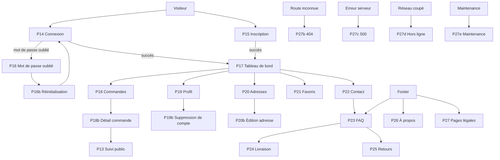
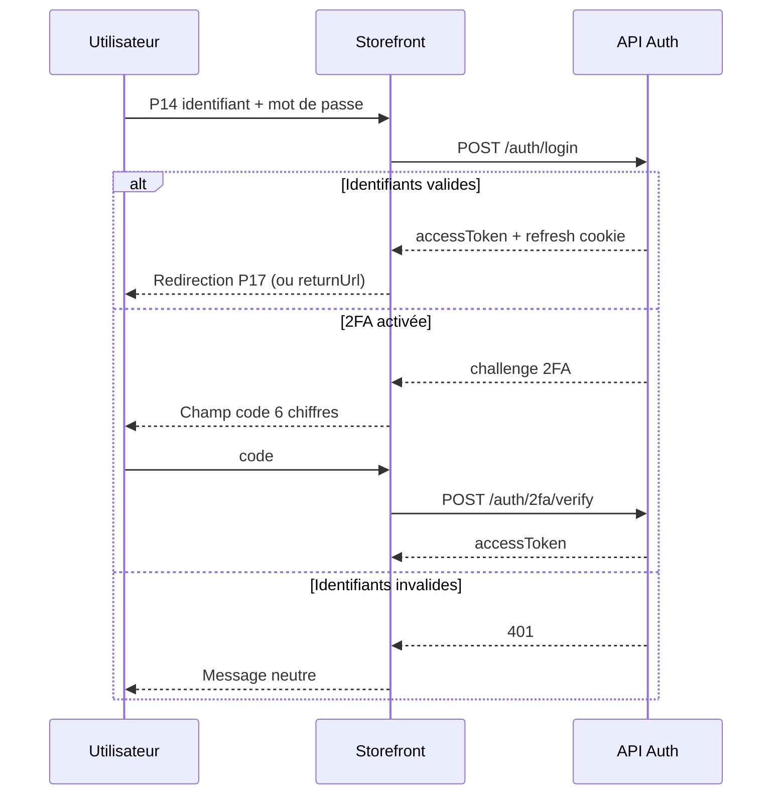
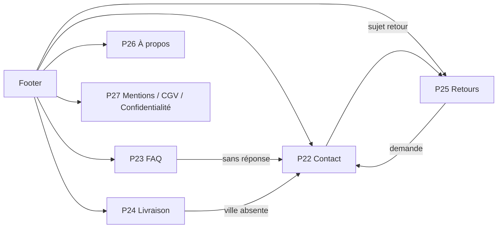
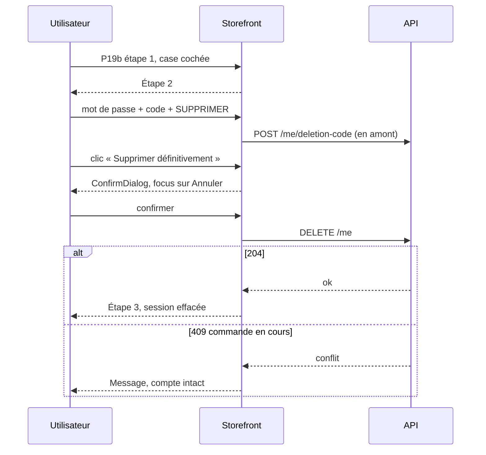

# Prototype — DSG-05

> **Option B** : prototype textuel (Mermaid + wireframes ASCII), faute d'outil Figma/Penpot dans l'environnement.
> Les 22 écrans sont couverts par 20 scénarios testables. Chaque scénario décrit un parcours complet, pas un écran isolé.

---

## 1. Cartographie des parcours



---

## 2. Parcours d'authentification



```text
P14                          P15
┌──────────────────┐         ┌──────────────────┐
│ Connexion        │         │ Créer un compte  │
│ [E-mail/tél.]    │         │ [E-mail][Tél.]   │
│ [Mot de passe]   │         │ [Prénom][Nom]    │
│ [Se connecter]   │         │ [Mot de passe]   │
│ Mot de passe oublié ?      │ [Force]          │
│ Créer un compte  │         │ ☐ CGV            │
└──────────────────┘         │ [Créer]          │
                             └──────────────────┘
```

---

## 3. Parcours compte

```mermaid
stateDiagram-v2
  [*] --> TableauDeBord
  TableauDeBord --> Commandes
  Commandes --> DetailCommande
  DetailCommande --> SuiviPublic
  TableauDeBord --> Profil
  Profil --> SuppressionEtape1
  SuppressionEtape1 --> SuppressionEtape2: case cochée
  SuppressionEtape2 --> ConfirmDialog: formulaire valide
  ConfirmDialog --> SuppressionEtape2: annuler
  ConfirmDialog --> CompteSupprimé: confirmer
  CompteSupprimé --> [*]
  TableauDeBord --> Adresses
  Adresses --> EditionAdresse
  TableauDeBord --> Favoris
```



```text
P17 Desktop
┌──────────────┬──────────────────────────────────┐
│ MON COMPTE   │ Bonjour Jean-Paul                │
│ Vue d'ensemble│ [Profil]  [Commande en cours]   │
│ Commandes    │ [Cmd][Adr][Fav][Profil]         │
│ Profil       │ Dernières commandes             │
│ Adresses     │ Adresse par défaut              │
│ Favoris      │ Besoin d'aide ?                 │
│ Déconnexion  │                                 │
└──────────────┴──────────────────────────────────┘
```

---

## 4. Parcours information



---

## 5. Les 20 scénarios testés

| # | Scénario | Écrans | Résultat attendu |
| --- | --- | --- | --- |
| 1 | Connexion e-mail valide | P14 → P17 | Redirection, prénom affiché, session en mémoire |
| 2 | Connexion avec `returnUrl` | P14 → P18 | Retour à la page demandée après connexion |
| 3 | Connexion 2FA | P14 | Champ code, vérification, redirection |
| 4 | Identifiants incorrects | P14 | Message neutre, aucun détail, formulaire conservé |
| 5 | Inscription e-mail + CGV | P15 → P17 | Compte créé, CGV 1.0 acceptées |
| 6 | Inscription téléphone | P15 | Format +237 validé, compte créé |
| 7 | Doublon d'inscription | P15 | 201 neutre, aucun message révélant l'existence du compte |
| 8 | Mot de passe oublié | P16 → P16b | Code envoyé, succès neutre, nouveau mot de passe |
| 9 | Code expiré | P16b | Message d'expiration, renvoi possible |
| 10 | Tableau de bord sans commande | P17 | Modules vides, CTA boutique, pas de faux compteur |
| 11 | Liste de commandes filtrée | P18 | Filtre dans l'URL, compteur et pagination corrects |
| 12 | Détail d'une commande expédiée | P18b → P13 | Timeline à jour, CTA suivi fonctionnel |
| 13 | Commande d'un autre compte | P18b | Message neutre « introuvable », pas de fuite |
| 14 | Mise à jour du profil | P19 | Validation, toast, valeurs conservées |
| 15 | Changement de mot de passe | P19 | Ancien mot de passe requis, erreurs ciblées |
| 16 | Suppression de compte complète | P19 → P19b | 3 étapes, `SUPPRIMER`, dialog, session effacée |
| 17 | Suppression annulée dans le dialog | P19b | Aucun appel DELETE, compte intact, focus restitué |
| 18 | Ajout puis suppression d'adresse | P20 → P20b | Repère obligatoire, confirmation, toast |
| 19 | Retrait d'un favori | P21 | Retrait optimiste, toast avec annulation |
| 20 | Parcours info + erreurs | P22–P27e | Contact, FAQ, livraison, retours, légales, 404/500/offline/maintenance |

---

## 6. Détail des scénarios critiques

### Scénario 16 — Suppression de compte



**Vérifications** : focus initial sur « Annuler », Échap ferme, aucun appel avant confirmation, `SUPPRIMER` sensible à la casse, code à usage unique, retour navigateur → état final.

### Scénario 17 — Annulation du dialog

1. Ouvrir P19b, compléter les étapes 1 et 2.
2. Cliquer sur « Supprimer définitivement mon compte ».
3. Le dialog s'ouvre, focus sur « Annuler ».
4. Appuyer sur Échap.
5. **Attendu** : dialog fermé, formulaire intact, aucun appel réseau, focus revenu sur le bouton d'ouverture.

### Scénario 11 — Filtre de commandes

1. Ouvrir P18 avec 3 commandes.
2. Sélectionner « En cours ».
3. **Attendu** : URL `?statut=en-cours`, 2 cartes, compteur « 2 commandes », pagination conservée.
4. Recharger la page : le filtre persiste.
5. Sélectionner un filtre sans résultat : `EmptyState` dédié + « Réinitialiser les filtres ».

### Scénario 19 — Retrait d'un favori

1. Ouvrir P21 avec 4 produits.
2. Cliquer sur le cœur d'un produit.
3. **Attendu** : carte retirée immédiatement, toast « Produit retiré de vos favoris. » avec « Annuler ».
4. Cliquer sur « Annuler » dans les 5 s : carte restaurée, aucun appel de suppression définitif.
5. Sans annulation : `DELETE` confirmé, compteur à 3.

---

## 7. Couverture des états

| Écran | Chargement | Vide | Erreur | Succès |
| --- | --- | --- | --- | --- |
| P14 | bouton | champs vides | 401 | redirection |
| P15 | bouton | formulaire | doublon/validation | redirection |
| P16 | bouton | e-mail vide | e-mail invalide | message neutre |
| P16b | bouton | code vide | code invalide/expiré | redirection P14 |
| P17 | skeletons | modules vides | erreurs locales | données |
| P18 | skeletons | aucune commande | erreur + retry | liste |
| P18b | skeleton | introuvable | 403/404/500 | détail |
| P19 | skeleton | champs | validation/409 | toast |
| P19b | boutons | case vide | code/mot de passe | étape 3 |
| P20 | skeletons | aucune adresse | erreur + retry | liste |
| P20b | skeleton | formulaire | validation | retour P20 |
| P21 | skeletons | aucun favori | erreur + retry | grille |
| P22 | bouton | formulaire | validation/envoi | confirmation |
| P23 | — | recherche vide | secours | accordéon |
| P24 | skeleton | aucune zone | secours seed | tableau |
| P25 | — | — | secours | contenu |
| P26 | — | — | image | contenu |
| P27 | — | — | secours | contenu |
| P27b–e | — | — | — | navigation |

---

## 8. Limites du prototype

- Pas de prototype cliquable : les transitions sont décrites, pas exécutables.
- Les états dépendant du backend non implémenté (commandes, adresses, favoris, contact, zones) sont spécifiés mais non testables en l'état.
- Aucune animation n'est prototypée ; seules les durées et intentions sont décrites.
- Le rendu typographique exact dépend des tokens et des composants TEC-10.
