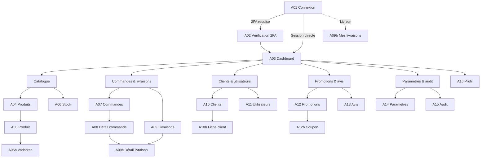

# Cartographie du back-office

## 1. Vue d’ensemble

## 2. Routes cibles

| Route | Écran | Accès | Redirection |
| --- | --- | --- | --- |
| `/admin/connexion` | A01 | Public | A03 si session, A02 si challenge |
| `/admin/verification-2fa` | A02 | Challenge token | A03 ou A09b |
| `/admin` | A03 | Tous internes | A01 si non authentifié |
| `/admin/produits` | A04 | Admin, stock | A03 si non autorisé |
| `/admin/produits/nouveau` | A05 | Admin, stock | — |
| `/admin/produits/:id/modifier` | A05 | Admin, stock | A04 si introuvable |
| `/admin/produits/:id/variantes` | A05b | Admin, stock | A05 |
| `/admin/stock` | A06 | Admin, stock, commandes (lecture) | A03 |
| `/admin/commandes` | A07 | Admin, commandes | A03 |
| `/admin/commandes/:reference` | A08 | Admin, commandes | A07 si introuvable |
| `/admin/livraisons` | A09 | Admin, commandes | A09b si livreur |
| `/admin/livraisons/mes-livraisons` | A09b | Livreur | A01 si non authentifié |
| `/admin/livraisons/:id` | A09c | Admin, commandes, livreur assigné | A09 ou A09b |
| `/admin/clients` | A10 | Admin, commandes | A03 |
| `/admin/clients/:id` | A10b | Admin, commandes | A10 si introuvable |
| `/admin/utilisateurs` | A11 | Admin, super admin | A03 |
| `/admin/promotions` | A12 | Admin, commandes | A03 |
| `/admin/promotions/nouvelle` | A12b | Admin, commandes | — |
| `/admin/promotions/:id/modifier` | A12b | Admin, commandes | A12 |
| `/admin/avis` | A13 | Admin, commandes | A03 |
| `/admin/parametres` | A14 | Admin, super admin | A03 |
| `/admin/audit` | A15 | Admin, super admin | A03 |
| `/admin/profil` | A16 | Tous internes | A01 |
| `/admin/acces-refuse` | 403 | Tous internes | — |
| `**` | 404 | — | A03 si session, sinon A01 |

## 3. Routes existantes et mapping

| Existant | Cible | Décision |
| --- | --- | --- |
| `/connexion` | `/admin/connexion` | Alias ou redirection selon le base href |
| `/produits` | `/admin/produits` | Remplacer la page publique par A04 |
| `/acces-refuse` | `/admin/acces-refuse` | Conserver, ajouter un lien retour |
| `**` → `/produits` | 404 dédiée | Créer une vraie page 404 |

Le base href actuel est `/`. Les specs utilisent les routes canoniques `/admin/...` ; l’implémentation peut conserver `/connexion` et `/produits` comme alias sans changer les maquettes.

## 4. Guards

| Guard | Rôle |
| --- | --- |
| `authGuard` | Vérifie la session, redirige vers A01 avec `returnUrl` |
| `roleGuard` | Vérifie les rôles requis, redirige vers 403 |
| `challengeGuard` | Autorise uniquement A02 avec un jeton de challenge valide |
| `guestGuard` | Empêche d’ouvrir A01 avec une session active |

Règles :

- `SUPER_ADMIN` satisfait tous les `roleGuard`.
- Un livreur est redirigé de A09 vers A09b.
- Un utilisateur non autorisé ne voit jamais un écran vide : il est redirigé vers 403.
- Les guards UI ne remplacent pas les contrôles backend.

## 5. Navigation par rôle

| Rôle | Entrées visibles |
| --- | --- |
| `SUPER_ADMIN` | Dashboard, Produits, Stock, Commandes, Livraisons, Clients, Utilisateurs, Promotions, Avis, Paramètres, Audit, Profil |
| `ADMIN` | Dashboard, Produits, Stock, Commandes, Livraisons, Clients, Utilisateurs, Promotions, Avis, Paramètres, Audit, Profil |
| `ORDER_MANAGER` | Dashboard, Commandes, Livraisons, Clients, Promotions, Avis, Profil |
| `STOCK_MANAGER` | Dashboard, Produits, Stock, Profil |
| `LIVREUR` | Ma tournée, Historique, Profil |

Ordre desktop recommandé : Dashboard · Produits · Stock · Commandes · Livraisons · Clients · Utilisateurs · Promotions · Avis · Paramètres · Audit.

## 6. Redirections après connexion

1. `SUPER_ADMIN` et `ADMIN` → A03.
2. `ORDER_MANAGER` → A03.
3. `STOCK_MANAGER` → A03.
4. `LIVREUR` → A09b.
5. Si `returnUrl` existe et est autorisée → cette route.
6. Si `returnUrl` est interdite → 403.

## 7. Dépendances de navigation

- A05b n’est accessible qu’après création ou depuis A05.
- A08 peut ouvrir A09c si une livraison existe.
- A09c est accessible depuis A09, A09b et A08.
- A10b peut filtrer A07 et A13.
- A16 est accessible depuis le menu utilisateur, pas depuis la navigation principale.
- A02 ne figure pas dans le menu.

## 8. Profondeur maximale

Aucune page ne dépasse **trois niveaux** : groupe → liste → détail. A05b est un sous-écran de A05, pas un quatrième niveau de navigation.
