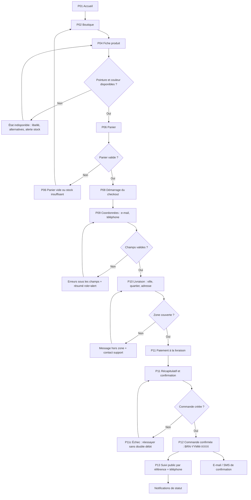
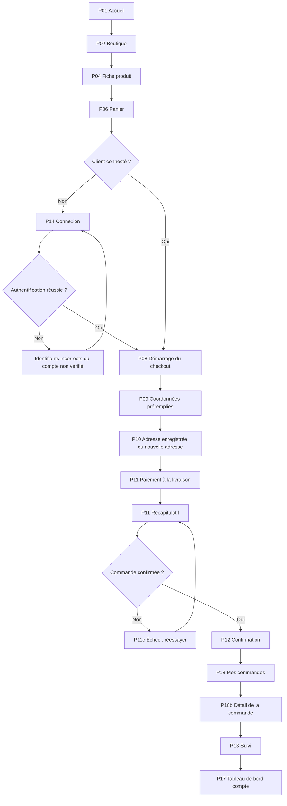
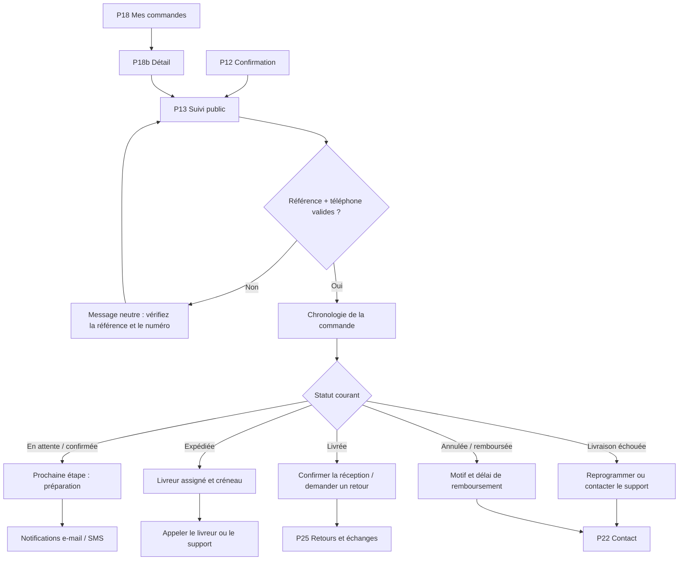
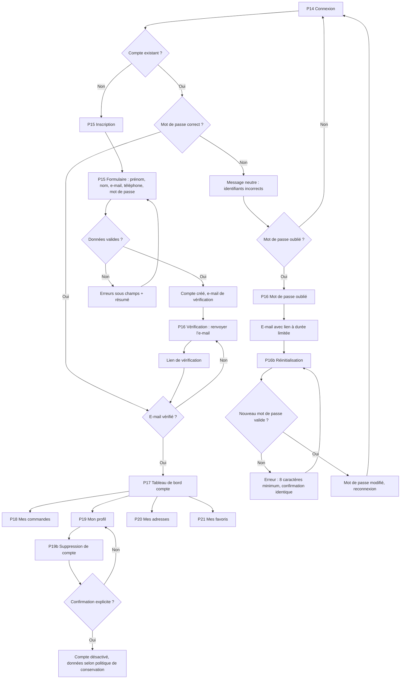
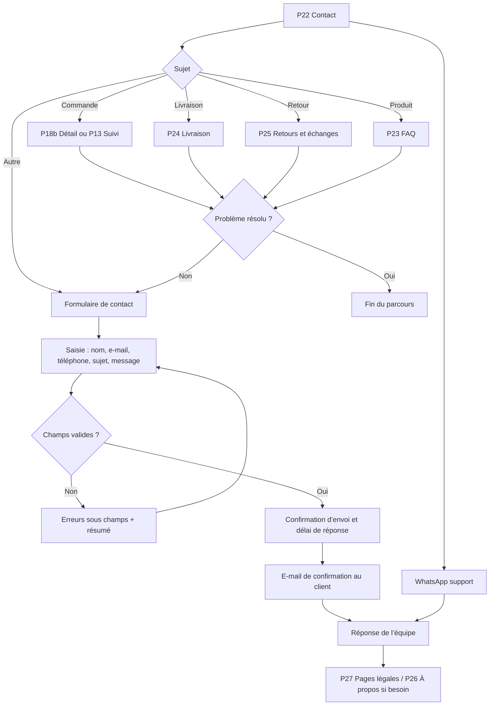
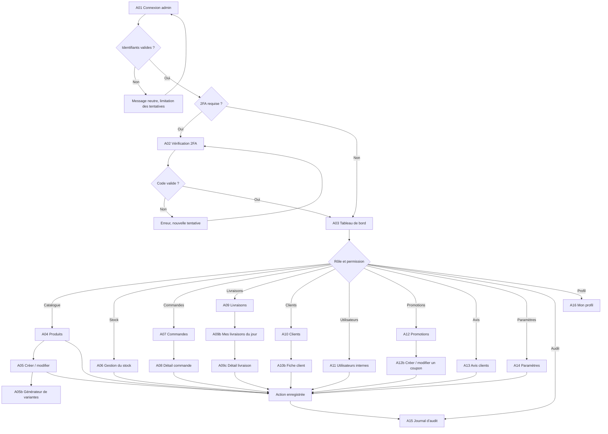

# Parcours UX — BrunyShop MVP

**Version** : 1.0.0 (gel MVP, 11 novembre 2026)
**Périmètre** : six parcours contractuels : achat invité, achat connecté, suivi, compte et récupération, support, administration.
**Convention** : `Pxx` = écran storefront, `Axx` = écran admin. Les écrans non implémentés sont décrits comme **cible** ; ils ne doivent pas être présentés comme disponibles.

## 1. Parcours d’achat invité

**Objectif** : permettre à un client sans compte de commander un article livré au Cameroun, en paiement à la livraison.
**Acteur** : visiteur.
**Préconditions** : produit publié, variante en stock, zone de livraison couverte.
**Postcondition** : commande créée avec une référence `BRN-YYMM-XXXX`, confirmation affichée et envoyée par e-mail/SMS si les coordonnées sont fournies.

**Étapes détaillées**

| # | Écran | Action | Résultat attendu | Erreur / alternative |
|---|---|---|---|---|
| 1 | P01/P02 | Parcourir et filtrer | Produits publiés, prix FCFA, stock visible | État vide avec réinitialisation des filtres |
| 2 | P04 | Choisir couleur et pointure | Variante sélectionnée, prix et stock à jour | Pointure indisponible nommée, pas seulement grisée |
| 3 | P06 | Vérifier le panier | Sous-total, livraison estimée, CTA « Passer la commande » | Stock insuffisant signalé avec quantité restante |
| 4 | P08 | Choisir « Continuer sans compte » | Formulaire invité | Ne pas forcer la création de compte |
| 5 | P09 | Saisir e-mail et téléphone | Validation inline | Erreurs sous champ, jamais seulement en rouge |
| 6 | P10 | Saisir l’adresse | Frais et délai calculés | Hors zone : ne pas bloquer sans issue |
| 7 | P11 | Choisir le paiement à la livraison | Récapitulatif complet | Paiement indisponible : message explicite |
| 8 | P12 | Lire la confirmation | Référence, montant, délai, lien de suivi | Commande en attente : statut clair |
| 9 | P13 | Suivre | Chronologie et prochaine étape | Référence inconnue : message neutre |

**Règles UX**

- Le compte n’est jamais obligatoire pour acheter.
- Le bouton primaire est unique par écran : « Continuer » dans le tunnel, « Confirmer la commande » au récapitulatif.
- Le récapitulatif est replié sur mobile, jamais supprimé.
- Les frais de livraison sont annoncés avant le paiement.
- Aucun faux compte à rebours, aucune pression artificielle.
- En cas d’échec, la saisie est conservée.

**Accessibilité**

- Focus déplacé sur le titre de l’étape suivante après navigation.
- Résumé d’erreurs en `role="alert"`, focus sur le premier champ invalide.
- Le choix de pointure est un groupe de boutons radio avec nom accessible complet.
- Le CTA sticky ne masque pas le dernier champ et respecte 44 × 44 px.
- Les statuts sont annoncés en `role="status"` ; la confirmation reçoit le focus.

**API et données**

- Catalogue : produits, variantes, stocks, prix.
- Livraison : zones, frais, délais.
- Commande : création idempotente, référence, statut initial `PENDING_CONFIRMATION`.
- Notification : e-mail/SMS de confirmation.

---

## 2. Parcours d’achat connecté

**Objectif** : réutiliser le compte, les adresses et l’historique pour réduire la saisie.
**Acteur** : client authentifié.
**Préconditions** : session valide, e-mail vérifié.
**Postcondition** : commande rattachée au compte, visible dans « Mes commandes ».

**Étapes détaillées**

| # | Écran | Action | Résultat attendu | Erreur / alternative |
|---|---|---|---|---|
| 1 | P02/P04 | Choisir un produit | Ajout au panier | Produit archivé : retiré avec message |
| 2 | P06 | Vérifier | Panier persistant | Session expirée : reconnexion sans perdre le panier |
| 3 | P14 | Se connecter | Redirection vers l’étape interrompue | Ne jamais révéler si l’e-mail existe |
| 4 | P08 | Démarrer | Coordonnées et adresses préremplies | L’utilisateur peut modifier |
| 5 | P10 | Choisir une adresse | Frais recalculés | Adresse supprimée entre-temps : message clair |
| 6 | P11 | Payer à la livraison | Commande créée | Idempotence conservée |
| 7 | P12 | Confirmation | Référence et lien de suivi | — |
| 8 | P18/P18b | Retrouver la commande | Statut et détail | Liste vide : état vide dédié |
| 9 | P17 | Revenir au compte | Tableau de bord à jour | — |

**Règles UX**

- La connexion est proposée, jamais imposée depuis le panier.
- Après connexion, l’utilisateur revient **à l’étape interrompue**, pas à l’accueil.
- Les adresses sont proposées par ordre : par défaut, récente, puis les autres.
- Une adresse peut être créée sans quitter le tunnel (P20b en modale).
- Le panier est fusionné avec le panier serveur sans doublon.

**Accessibilité**

- Le formulaire de connexion a des labels persistants et `autocomplete`.
- L’erreur d’authentification est annoncée sans déplacer le focus hors du formulaire.
- Le retour d’étape restaure le focus sur le titre.
- Les adresses sont un groupe de radios avec adresse complète dans le nom.

**API et données**

- Auth : session, refresh, vérification d’e-mail.
- Panier : fusion locale/serveur.
- Adresses : liste, défaut, création, mise à jour.
- Commandes : création, liste, détail.

---

## 3. Parcours de suivi de commande

**Objectif** : consulter l’état d’une commande sans compte, puis agir en cas de problème.
**Acteur** : client invité ou connecté.
**Préconditions** : référence de commande et téléphone (invité) ou session (connecté).
**Postcondition** : le client connaît le statut, la prochaine étape et le moyen de contacter le support.

**Étapes détaillées**

| # | Écran | Action | Résultat attendu | Erreur / alternative |
|---|---|---|---|---|
| 1 | P12 | Ouvrir le lien de suivi | P13 avec référence préremplie | Lien expiré : saisie manuelle |
| 2 | P13 | Saisir référence + téléphone | Chronologie affichée | Message neutre, pas d’énumération de comptes |
| 3 | P13 | Lire le statut | Libellé, date, prochaine étape | Statut inconnu : « En cours de mise à jour » |
| 4 | P13 | Agir | Retour, contact, reprogrammation | Action indisponible : masquée, pas grisée sans explication |
| 5 | P18b | Voir le détail connecté | Articles, adresse, paiement, historique | — |
| 6 | P22 | Contacter | Formulaire prérempli avec la référence | — |

**Règles UX**

- Le suivi public ne montre **aucune** donnée personnelle complète : adresse masquée, téléphone partiel.
- La chronologie utilise les 13 statuts backend, jamais un statut marketing.
- « Livrée » n’est pas synonyme de « paiement encaissé » : les deux informations sont distinctes.
- Le délai est exprimé en jours ouvrés.
- En cas de retard, afficher une explication et une action, pas seulement « en retard ».

**Accessibilité**

- La chronologie est une liste ordonnée (`ol`) avec `aria-current="step"` sur l’étape courante.
- Chaque statut possède un texte, une icône et une date ; la couleur n’est jamais seule.
- Le formulaire de recherche a des labels et un `autocomplete` adapté.
- Les messages d’erreur sont annoncés sans révéler l’existence d’une commande.

**API et données**

- Suivi public : référence + téléphone, réponse minimisée.
- Commande connectée : détail et historique.
- Livraison : statut, livreur, créneau, échec.
- Notifications : e-mail/SMS à chaque transition.

---

## 4. Parcours compte et récupération

**Objectif** : créer un compte, se connecter, récupérer un mot de passe et gérer ses données.
**Acteur** : visiteur, client.
**Préconditions** : aucune pour l’inscription ; e-mail ou téléphone pour la récupération.
**Postcondition** : compte actif, session valide, données modifiables ou compte supprimé.

**Étapes détaillées**

| # | Écran | Action | Résultat attendu | Erreur / alternative |
|---|---|---|---|---|
| 1 | P14 | Se connecter | Session ouverte | Message neutre, jamais « e-mail inconnu » |
| 2 | P15 | Créer un compte | Compte `PENDING_VERIFICATION` | Doublon : proposer connexion ou récupération |
| 3 | P16 | Vérifier l’e-mail | Lien à durée limitée | Lien expiré : renvoyer |
| 4 | P16 | Mot de passe oublié | Réponse toujours identique | Ne pas divulguer l’existence du compte |
| 5 | P16b | Réinitialiser | Mot de passe modifié | Lien invalide : recommencer |
| 6 | P17 | Accéder au compte | Vue d’ensemble | Session expirée : reconnexion |
| 7 | P19/P20/P21 | Gérer ses données | Sauvegarde confirmée | Conflit : message et conservation |
| 8 | P19b | Supprimer le compte | Confirmation, puis déconnexion | Commande en cours : expliquer le blocage |

**Règles UX**

- Pas de doublon de compte : e-mail **ou** téléphone identifie un compte.
- Le mot de passe n’est jamais affiché en clair par défaut ; le bouton « Afficher » est explicite.
- Le lien de réinitialisation est à usage unique et expire.
- La suppression de compte est une action destructive avec confirmation et conséquences.
- Les commandes en cours ne sont pas supprimées silencieusement.

**Accessibilité**

- `autocomplete` correct sur tous les champs.
- Le bouton « Afficher le mot de passe » a un nom accessible et un état `aria-pressed`.
- Les erreurs sont reliées au champ et annoncées.
- La modale de suppression est un `alertdialog`, focus sur « Annuler ».
- Les onglets de compte sont de vrais liens ou des tabs ARIA avec navigation aux flèches.

**API et données**

- Auth : inscription, vérification, connexion, refresh, déconnexion.
- Récupération : demande neutre, jeton à usage unique.
- Profil : lecture, mise à jour, suppression.
- Adresses et favoris : CRUD.

---

## 5. Parcours support

**Objectif** : trouver une réponse ou joindre l’équipe sans quitter le site.
**Acteur** : visiteur ou client.
**Préconditions** : aucune.
**Postcondition** : réponse trouvée ou demande envoyée avec un délai de réponse annoncé.

**Étapes détaillées**

| # | Écran | Action | Résultat attendu | Erreur / alternative |
|---|---|---|---|---|
| 1 | P22 | Choisir un sujet | Redirection vers la bonne aide | — |
| 2 | P23 | Lire la FAQ | Réponse immédiate | Recherche sans résultat : contacter |
| 3 | P24 | Comprendre la livraison | Zones, délais, frais | Zone non couverte : contact |
| 4 | P25 | Connaître les retours | Conditions, délais, procédure | Produit non éligible : expliquer |
| 5 | P22 | Envoyer un message | Accusé et délai | Échec réseau : conserver le message |
| 6 | WhatsApp | Discuter | Réponse humaine | Hors horaires : message d’attente |

**Règles UX**

- Le délai de réponse est annoncé : **24 h ouvrées**.
- Le formulaire reprend la référence de commande si elle existe.
- Aucune pièce jointe obligatoire ; si ajout, formats et taille sont indiqués.
- Les liens légaux sont accessibles depuis le footer de toutes les pages.
- Les horaires et le numéro WhatsApp sont ceux validés par l’exploitation.

**Accessibilité**

- Les liens WhatsApp ont un nom accessible « Contacter le support sur WhatsApp ».
- Le formulaire a des labels persistants ; le message accepte le collage clavier.
- Le compteur de caractères est annoncé sans interrompre la saisie.
- La confirmation d’envoi est un `role="status"`.

**API et données**

- Contenu : FAQ, pages légales, informations livraison/retours.
- Contact : création de demande, accusé, routage.
- WhatsApp : lien externe, ouverture dans un nouvel onglet avec avertissement.

---

## 6. Parcours administration

**Objectif** : gérer le catalogue, les commandes, les livraisons, les clients et les paramètres selon le rôle.
**Acteur** : `SUPER_ADMIN`, `ADMIN`, `ORDER_MANAGER`, `STOCK_MANAGER`, `LIVREUR`.
**Préconditions** : compte interne actif, 2FA si activée, permission sur le module.
**Postcondition** : action tracée dans le journal d’audit, données à jour.

**Étapes détaillées**

| # | Écran | Action | Résultat attendu | Erreur / alternative |
|---|---|---|---|---|
| 1 | A01 | Se connecter | Session admin | Compte non autorisé : accès refusé sans détail |
| 2 | A02 | Valider le 2FA | Session élevée | Code expiré : renvoyer |
| 3 | A03 | Lire le tableau de bord | Indicateurs et alertes | Donnée indisponible : état partiel explicite |
| 4 | A04/A05 | Gérer un produit | Produit créé/modifié | Validation, conflit de SKU |
| 5 | A05b | Générer des variantes | Combinaisons taille/couleur | Doublon : signalé |
| 6 | A06 | Ajuster le stock | Mouvement tracé | Stock négatif interdit |
| 7 | A07/A08 | Traiter une commande | Statut mis à jour | Transition invalide refusée |
| 8 | A09/A09b/A09c | Livrer | Statut et preuve | Hors ligne : file d’attente |
| 9 | A10/A10b | Consulter un client | Fiche et historique | Données minimisées |
| 10 | A11–A16 | Administrer | Action tracée | Permission refusée : 403 |

**Règles UX**

- Le menu est filtré par permission ; une URL directe non autorisée renvoie vers « Accès refusé ».
- Les actions destructives sont confirmées et journalisées.
- Les tables ont une `caption`, un tri annoncé et des actions nommées avec la ligne.
- Le mode mobile utilise des cartes, pas un tableau horizontal.
- Les statuts et libellés viennent du glossaire.
- Toute promesse de fonctionnalité absente (PDF, GPS, Prestige) est retirée ou marquée « bientôt disponible ».

**Accessibilité**

- Lien d’évitement vers le contenu principal.
- Sidebar navigable au clavier, `aria-current="page"`.
- Tableaux avec en-têtes `scope`, caption et résumé de tri.
- Modales `alertdialog` pour les suppressions.
- Notifications d’action en `role="status"`.
- Le mode hors ligne du livreur annonce l’état et la synchronisation.

**API et données**

- Auth admin, 2FA, permissions.
- Produits, variantes, stocks, commandes, livraisons, clients, utilisateurs, coupons, avis, paramètres, audit.
- Toute mutation est autorisée côté serveur, pas seulement masquée côté interface.

---

## 7. Matrice de couverture

| Parcours | Écrans | Implémenté aujourd’hui | Cible MVP |
|---|---|---|---|
| Achat invité | P01–P13 | Partiel : P01–P06, aucune commande | Complet |
| Achat connecté | P01–P18b | Auth partielle, commande absente | Complet |
| Suivi | P12, P13, P18b | Absent | Complet |
| Compte et récupération | P14–P21 | Absent | Complet |
| Support | P22–P27e | Absent | Complet |
| Administration | A01–A16 | Connexion + produits uniquement | Complet par vagues |

**Lecture honnête** : les parcours décrivent la **cible validée par le design**, pas l’état actuel du produit. Aucun parcours ne doit être annoncé comme disponible tant que ses écrans et ses API ne sont pas implémentés et testés.
