# Schéma de données — TEC-06

> Source de vérité unique : [`backend/prisma/schema.prisma`](../backend/prisma/schema.prisma)
> (Prisma 7.10 · PostgreSQL 18 · propriétaire des données : l'application).
> Vérifié le 24 octobre 2026 : 27 modèles, 9 enums, 4 migrations appliquées.

## 1. Conventions

| Règle | Application dans le schéma |
| --- | --- |
| **Identifiants** | `id String @id @default(uuid())` sur les **23 entités métier** ; valeurs UUID (stockées en `text`, pas de colonne native `@db.Uuid`) |
| **Tables de jointure** | Clés composites `@@id([fk1, fk2])` : `UserRole`, `RolePermission`, `OrderCoupon` |
| **Horodatage** | `createdAt` + `updatedAt` sur 25/27 et 24/27 modèles (les 3 jointures utilisent `assignedAt`/`createdAt` — voir §6) |
| **Montants (XAF)** | **Toujours `Int`** — aucun `Decimal` ni `Float` (règle RG-PRX-01, devise sans décimale) |
| **Suppression logique** | `deletedAt` **uniquement** sur `User`, `Product` et `Order` ; suppression physique partout ailleurs |
| **Instantanés de commande** | `OrderItem` fige nom, pointure, couleur et prix unitaire au moment de l'achat |
| **Adresses figées** | `Order.addressSnapshot Json` : une modification d'adresse ultérieure n'altère pas l'historique |

## 2. Diagramme entité-relation

```mermaid
erDiagram
    User ||--o{ UserRole : "rôle assigné"
    Role ||--o{ UserRole : "rôle assigné"
    Role ||--o{ RolePermission : "permission"
    Permission ||--o{ RolePermission : "permission"
    User ||--o{ RefreshToken : "session"
    User ||--o{ Address : "adresse"
    User ||--o{ Order : "commande"
    User ||--o{ Cart : "panier"
    User ||--o{ Review : "avis"
    User ||--o{ Wishlist : "favori"
    User ||--o{ StockMovement : "mouvement"
    User ||--o{ AuditLog : "journal"
    User ||--o{ BackupCode : "code 2FA"
    User ||--o{ Shipment : "livraison"
    Category |o--o{ Category : "hiérarchie"
    Category ||--o{ Product : "produit"
    Brand ||--o{ Product : "produit"
    Product ||--o{ ProductVariant : "variante"
    Product ||--o{ ProductImage : "image"
    Product ||--o{ Review : "avis"
    Product ||--o{ Wishlist : "favori"
    ProductVariant ||--o{ CartItem : "ligne"
    ProductVariant ||--o{ OrderItem : "ligne"
    ProductVariant ||--o{ StockMovement : "mouvement"
    Cart ||--o{ CartItem : "ligne"
    Order ||--o{ OrderItem : "ligne"
    Order ||--o{ Payment : "paiement"
    Order ||--o{ OrderCoupon : "coupon"
    Coupon ||--o{ OrderCoupon : "coupon"
    Order ||--|| Shipment : "expédition"
    DeliveryZone ||--o{ Shipment : "zone"

    User {
        uuid id PK
        string email UK "ou phone"
        string phone UK "ou email"
        string passwordHash
        enum status "UserStatus"
        datetime deletedAt "logique"
        datetime createdAt
        datetime updatedAt
    }
    Role {
        uuid id PK
        string name UK
        string_arr permissions
    }
    Permission {
        uuid id PK
        string key UK
        string description
    }
    RolePermission {
        uuid roleId PK
        uuid permissionId PK
        datetime assignedAt
    }
    UserRole {
        uuid userId PK
        uuid roleId PK
        datetime assignedAt
    }
    RefreshToken {
        uuid id PK
        string tokenHash UK
        string familyId "rotation"
        datetime expiresAt
        datetime revokedAt
    }
    Address {
        uuid id PK
        uuid userId FK
        string city
        string district
        string line
        string landmark
    }
    Category {
        uuid id PK
        string slug UK
        uuid parentId FK "auto-référence"
        int position
    }
    Brand {
        uuid id PK
        string name
        string slug UK
        string logo
    }
    Product {
        uuid id PK
        string slug UK
        enum status "ProductStatus"
        int basePrice "XAF"
        int promoPrice "XAF"
        datetime deletedAt "logique"
        datetime createdAt
        datetime updatedAt
    }
    ProductVariant {
        uuid id PK
        string sku UK
        string color
        string size
        int price "XAF"
        int stock
        int reservedStock
        int version "optimiste"
    }
    ProductImage {
        uuid id PK
        uuid productId FK
        string url
        int position
    }
    Cart {
        uuid id PK
        uuid userId FK "null = invité"
        string token UK "panier invité"
    }
    CartItem {
        uuid id PK
        uuid cartId PK
        uuid variantId FK
        int quantity
    }
    Order {
        uuid id PK
        string reference UK "BRN-2610-7K3F"
        uuid userId FK "null = invité"
        enum status "OrderStatus"
        int subtotal "XAF"
        int discount "XAF"
        int shippingFee "XAF"
        int total "XAF"
        json addressSnapshot "figée"
        datetime deletedAt "logique"
        datetime createdAt
        datetime updatedAt
    }
    OrderItem {
        uuid id PK
        uuid orderId FK
        uuid variantId FK
        string nameSnapshot "figé"
        string sizeSnapshot "figé"
        string colorSnapshot "figé"
        int unitPrice "XAF figé"
        int quantity
    }
    Payment {
        uuid id PK
        uuid orderId FK
        string provider "cod, mtn_momo..."
        int amount "XAF"
        enum status "PaymentStatus"
        datetime paidAt
    }
    Shipment {
        uuid id PK
        uuid orderId UK "1-1"
        uuid zoneId FK
        uuid driverId FK "livreur"
        enum status "ShipmentStatus"
        bool codCollected
    }
    DeliveryZone {
        uuid id PK
        string name
        string_arr cities
        int fee "XAF"
        int estimatedDays
    }
    Coupon {
        uuid id PK
        string code UK
        enum type "CouponType"
        int value "% ou XAF"
        int maxUses "null = illimité"
        int usedCount
    }
    OrderCoupon {
        uuid orderId PK
        uuid couponId PK
        datetime createdAt
    }
    Review {
        uuid id PK
        uuid productId FK
        uuid userId FK
        int rating "1-5"
        enum status "ReviewStatus"
    }
    Wishlist {
        uuid id PK
        uuid userId PK
        uuid productId PK
    }
    StockMovement {
        uuid id PK
        uuid variantId FK
        int delta "signé"
        enum reason "StockMovementReason"
        int before
        int after
    }
    AuditLog {
        uuid id PK
        uuid userId FK
        string action
        string entity
        json before
        json after
    }
    Setting {
        string key PK "clé naturelle"
        json value
    }
    BackupCode {
        uuid id PK
        uuid userId FK
        string codeHash "argon2id"
        datetime usedAt
    }
```

## 3. Enums

| Enum | Valeurs | Rôle |
| --- | --- | --- |
| `UserStatus` | `ACTIVE`, `SUSPENDED`, `DISABLED` | État du compte |
| `ProductStatus` | `DRAFT`, `PUBLISHED`, `ARCHIVED` | Publication catalogue |
| `OrderStatus` | `PENDING_CONFIRMATION`, `AWAITING_PAYMENT`, `CONFIRMED`, `PAID`, `PREPARING`, `SHIPPED`, `DELIVERED`, `DELIVERY_FAILED`, `CANCELLED`, `RETURN_REQUESTED`, `RETURNED`, `REFUNDED`, `EXCHANGED` | Cycle de vie commande (13 états) |
| `PaymentStatus` | `PENDING`, `SUCCEEDED`, `FAILED`, `REFUNDED` | État du paiement |
| `PaymentMethod` | `COD`, `MOBILE_MONEY`, `CARD` | Moyen de paiement (MVP : COD) |
| `ShipmentStatus` | `PENDING`, `ASSIGNED`, `IN_TRANSIT`, `DELIVERED`, `FAILED`, `RETURNED` | Livraison |
| `CouponType` | `PERCENTAGE`, `FIXED_AMOUNT` | Type de remise (= `DiscountType` du ticket) |
| `ReviewStatus` | `PENDING`, `APPROVED`, `REJECTED` | Modération des avis |
| `StockMovementReason` | `RESTOCK`, `RESERVATION`, `RELEASE`, `PURCHASE`, `CANCELLATION`, `ADJUSTMENT`, `RETURN` | Motif de mouvement de stock (= `StockMovementType` du ticket) |

## 4. Index et contraintes d'unicité

| Élément | Contrainte | Modèle |
| --- | --- | --- |
| `User.email`, `User.phone` | `@unique` | identification (email **ou** téléphone) |
| `Order.reference` | `@unique` | référence client non devinable (`BRN-2610-7K3F`) |
| `ProductVariant.sku` | `@unique` | référence stock |
| `Product.slug`, `Category.slug`, `Brand.slug` | `@unique` | URL d'administration |
| `RefreshToken.tokenHash` | `@unique` | jeton opaque stocké haché |
| `Cart.token` | `@unique` | panier invité |
| `Order.idempotencyKey` | `@unique` | anti double-soumission |
| `@@index([status])` | index | `Product`, `Order` |
| `@@index([deletedAt])` | index | `Order` (soft-delete) |
| Index FK | `@@index` | `userId`, `orderId`, `productId`, `variantId`, `categoryId`, `brandId`, `familyId`, `zoneId`, `driverId`, `entity+entityId`… |
| `@@unique([cartId, variantId])` | index unique | `CartItem` (pas de doublon de ligne) |
| `@@unique([userId, productId])` | index unique | `Wishlist` |
| `@@unique([orderId])` | 1-1 | `Shipment` |

## 5. Migrations

| Fichier | Apport |
| --- | --- |
| `20261014081950_init` | Schéma initial (catalogue, panier, commandes, livraison) |
| `20261014092900_auth_refresh_family_and_backup_codes` | Familles de refresh tokens + codes de secours 2FA |
| `20261014094916_allow_phone_only_accounts` | Comptes sans email (connexion téléphone) |
| `20261014130000_permissions_and_order_soft_delete` | Table `Permission` + `deletedAt` sur `Order` |

**Preuve CA5** (base vide, rejouée le 24/10/2026) : `prisma migrate deploy` sur une base
`bruny_tec06_probe` fraîchement créée → *« All migrations have been successfully applied »*,
28 tables créées (27 modèles + `_prisma_migrations`), 4/4 migrations `finished`, base de
données principale inchangée, base de test supprimée ensuite.
Sur la base de développement : `prisma migrate status` → *« Database schema is up to date! »*.

## 6. Écarts documentés au ticket TEC-06

Décision validée : **conformité + documentation, aucune réécriture du schéma** (le code, le
seed et les 4 migrations existants consomment les valeurs actuelles).

| Écart | Détail | Justification |
| --- | --- | --- |
| Valeurs des enums | ex. `PaymentStatus.SUCCEEDED` (pas `PAID`), `UserStatus.DISABLED` (pas `INACTIVE`/`DELETED`), `OrderStatus` en 13 valeurs | Les valeurs sont consommées par le code applicatif, le seed et les migrations ; un alignement = migration de réécriture + refonte du code. Les 4 enums **demandés au CA6 existent tous** |
| `AddressType` absent | `Address` n'a pas de type shipping/billing | Jamais utilisé dans le MVP (une seule adresse de livraison par commande, figée en snapshot) |
| Colonnes UUID natives | Pas de `@db.Uuid` (stockage `text`) | Les **valeurs** sont bien des UUID ; un changement de type réécrirait toutes les tables |
| `Setting.id` | Clé naturelle `key String @id` | Registre clé/valeur ; un UUID ajouterait une colonne sans valeur métier |
| Jointures sans `updatedAt` | `RolePermission`, `UserRole`, `OrderCoupon` | `assignedAt`/`createdAt` suffisent sur des tables de lien sans mise à jour |
| Index `createdAt` | Aucun index sur les dates de création | Écart assumé à ce stade : à ajouter en migration **additive** si les listings admin triés par date deviennent lents |

## 7. Aller plus loin

- Génération du client TypeScript : `pnpm api:generate` (depuis un serveur en marche) ou `pnpm -C backend openapi:export` (contrat figé).
- Seed de démonstration : `pnpm db:seed` (refusé en production).
